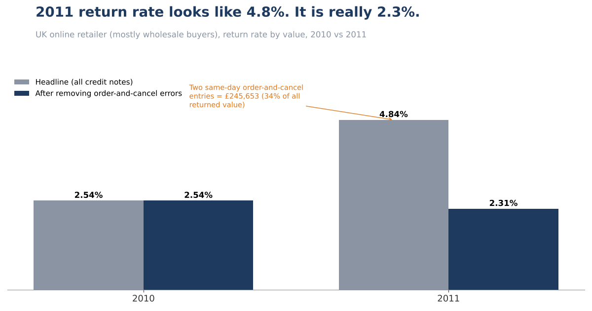
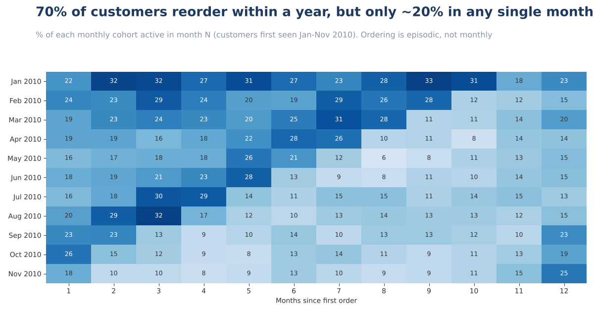
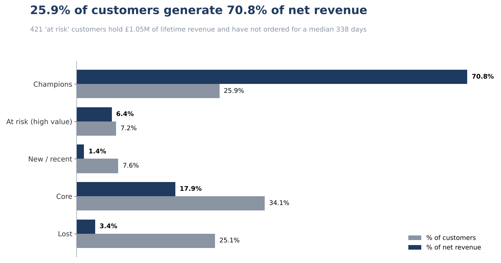

# UK Retail: Where Does Revenue Leak, and Who Is Worth Winning Back?



**Question:** A UK online retailer (mostly wholesale buyers) wants one trusted view of revenue, returns and customer retention. Which numbers can it rely on, and where should a retention budget go?

| | |
|---|---|
| **Answer** | Reported returns are overstated by two same-day order-and-cancel entries worth £245,653 (34% of all returned value). The genuine 2011 return rate is **2.31%, not 4.84%**. |
| **Recommendation** | Fix the KPI definitions first, then spend retention budget on **423 high-value customers who stopped ordering** after the 2010 peak season. |
| **Impact (scenario)** | Winning back 10-20% of them is worth roughly **£53k-£106k a year**, about 0.6% to 1.2% of annual net revenue. Assumptions below. |
| **Data** | UCI *Online Retail II*, 1,067,371 invoice lines, Dec 2009 to Dec 2011, real transactions |
| **Tools** | SQL (DuckDB, PostgreSQL-compatible syntax), Python for the runner and charts |

---

## 1. Business problem
Finance, operations and marketing would each compute "revenue" and "return rate" from the same file and get different answers. Before anyone allocates a retention budget, the KPIs need one definition and a reconciliation.

## 2. Data
Two Excel sheets, 53,628 invoices, 5,942 identified customers, 43 countries. Known issues are in [`docs/data_quality_log.md`](docs/data_quality_log.md). The dataset is widely used for tutorials, so this project does not do exploratory charts. It focuses on KPI definition, reconciliation and a decision.

## 3. Cleaning (what changed the numbers)

| Issue | Rows | Decision |
|---|---|---|
| Exact duplicate rows | 34,335 | Removed (-£431,717, 2.2% of the naive total) |
| Fees and adjustments (postage, bank charges, Amazon fees) | 5,980 | Excluded from product revenue |
| Missing customer ID | 226,965 | Kept for revenue, excluded from customer analysis |
| Order-and-cancel entries over £5,000 | 2 events | Tagged as errors, not returns |

## 4. Analysis

**Three plausible "revenue" numbers.** All come from the same file.

| Definition | £ |
|---|---|
| Naive: sum of quantity x price over every row | 19,287,251 |
| Gross product sales (sale lines only) | 19,642,692 |
| **Net product revenue** (gross product sales minus returns, no fees, no duplicates) | **18,926,266** |

**Returns.** The 2011 headline return rate nearly doubles (2.54% to 4.84%). Two entries explain it: customer 16446 ordered and cancelled 80,995 units of one product on the same day (£168,470), and customer 12346 did the same with 74,215 units in January 2011 (£77,184). Without them, 2011 is 2.31%, in line with 2010. After this correction, the top 20 customers still account for 37.9% of returned value.

**Retention.** 70% of customers reorder within 12 months, but only about 20% order in any single month. Customers buy in bursts, so a monthly "churn" KPI would misread this business.



**Segments.** 23.5% of customers (Champions) generate 69.5% of net revenue.



## 5. Key insight
The most important number in the file was wrong, and the error could easily have triggered a wasted returns investigation. Separately, 423 customers who ordered often (RFM frequency score 4-5) have been silent for a median 338 days. 65% of them bought in Q4 2010, then not again.

## 6. Recommendation
1. **Publish one definition** of net product revenue and return rate ([`docs/kpi_definitions.md`](docs/kpi_definitions.md)). Review any credit note over £5,000 that matches a sale in the previous week before it enters reporting.
2. **Win-back campaign** for the 423 high-value customers, timed before the next peak season (September-October). Owner: account management.
3. **Capture customer ID on every order.** 13.6% of net product revenue (£2.57M) cannot be tied to a customer, so it cannot be retained or segmented.
4. **Account review** with the top 20 returning customers (37.9% of returned value).

## 7. Business impact (scenario, not a forecast)
At-risk customers averaged £2,498 of net revenue over the 24-month file, about £1,249 a year. If 10% to 20% (42 to 85 customers) return to that spend, revenue is **£53k to £106k a year**. Assumes they return to historical average spend and ignores campaign cost.

## Validation
`sql/06_tieout_tests.sql` reconciles every headline number. All six tests pass:

| Test | Result |
|---|---|
| Net = gross + returns | PASS |
| Every line has exactly one line type | PASS |
| No exact duplicates remain | PASS |
| No sale line has non-positive quantity or price | PASS |
| RFM revenue + excluded customers = total identified net revenue | PASS |
| Cohort sizes sum to distinct buying customers | PASS |

## Limitations
- One retailer and two years of history. Results do not generalise.
- First purchase means first seen in this file. The Dec 2009 cohort is excluded.
- "At risk" is a rule-based segment, not a predictive model.
- The £5,000 / 7-day order-error rule is a judgement call. A lower threshold would also catch ordinary exact-quantity returns.
- Duplicate removal assumes repeated rows are errors. Keeping them adds £0.43M.

## How AI was used
See [`docs/ai_log.md`](docs/ai_log.md): what AI drafted, two mistakes it made that the tie-out tests caught, and the judgement calls to challenge.

## Reproduce
```
pip install duckdb pandas matplotlib openpyxl
# download online_retail_II.xlsx from https://archive.ics.uci.edu/dataset/502/online+retail+ii
# combine both sheets into data/online_retail_ii.csv (columns unchanged)
python python/run_analysis.py
python python/make_charts.py
```

## Repo map
`sql/` pipeline in run order | `python/` runner and chart code | `docs/` KPI definitions, data quality log, AI log | `images/` README visuals

*Data: UCI Machine Learning Repository, Online Retail II. Check the source page for licence terms.*
